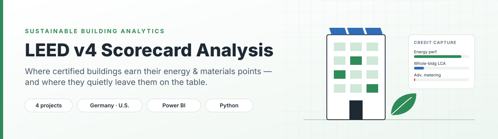
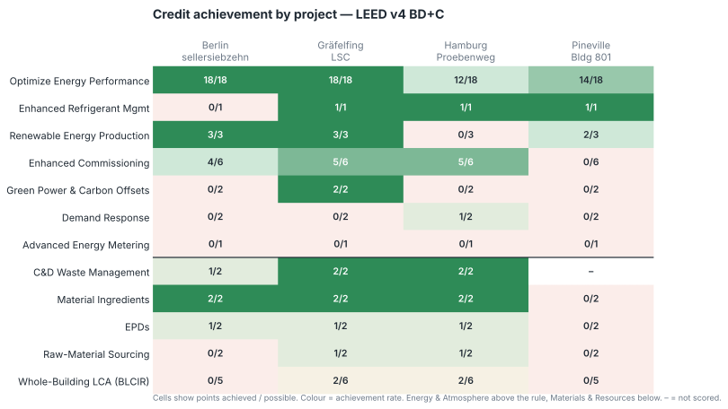
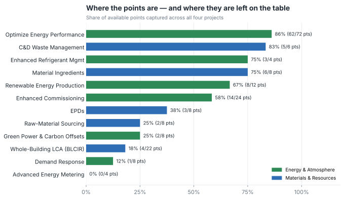
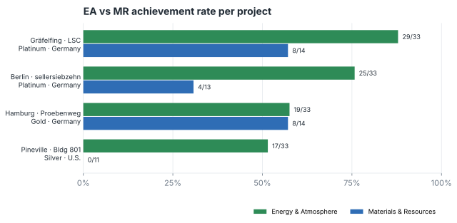

<p align="center">
  
</p>

<p align="center">
  
  
  
  
</p>

## In one paragraph

Green building certificates are awarded on design intent, but a building's carbon footprint is decided in operation. I took the public LEED v4 scorecards of four certified projects (three in Germany, one in the U.S.) and broke down every **Energy & Atmosphere (EA)** and **Materials & Resources (MR)** credit to see which ones teams actually go after. The pattern is consistent: points for *modelled* energy performance are nearly maxed out, while the credits that would prove performance after handover — metering, demand response, whole-building LCA — are mostly ignored.

---

## Key findings

| # | Finding | Evidence |
|---|---------|----------|
| 1 | **Energy modelling is where the points are.** | *Optimize Energy Performance* averages **15.5 / 18** pts and captures 86 % of available points across all projects. |
| 2 | **Nobody earned Advanced Energy Metering.** | **0 of 4** projects scored it — the one credit that makes post-occupancy verification routine. |
| 3 | **Embodied carbon is the blind spot.** | *Whole-Building LCA* captures only **18 %** of its points; two of four projects scored zero. |
| 4 | **EA tracks the certificate, MR doesn't.** | EA points rise with certification level (Spearman ρ = **0.95**); for MR the link is much weaker (ρ = 0.50). |
| 5 | **German projects lead on materials.** | MR achievement **49 %** in the German projects vs. **0 %** for the U.S. project. |

> **What this means in practice:** a Platinum plaque says a lot about the energy model and very little about whether the building is measured, flexible or low in embodied carbon. That's the gap ISO 50001 energy management and EU Level(s)/EPBD reporting are moving to close.

---

## Results

### Credit-by-credit view



### Which credits get chased — and which get skipped



### EA vs MR by project



The Silver-rated Pineville project has the lowest EA score (17 / 33) and scored nothing in MR. Its strengths are narrow — solid modelled energy savings (14 / 18) and on-site renewables (2 / 3) — with no commissioning or material-transparency points.

### Interactive Power BI dashboard

[`Scorecard_Analysis2507_updated.pbix`](Scorecard_Analysis2507_updated.pbix) contains the interactive version with country and project filters.


---

## Projects analysed

| Project | Country | Level |
|---|---|---|
| Berlin · sellersiebzehn | Germany | Platinum |
| Gräfelfing · Life Science Center (LSC) | Germany | Platinum |
| Hamburg · Proebenweg | Germany | Gold |
| Pineville · Building 801 Replacement | U.S. | Silver |

All four were certified under LEED v4 BD+C. Source: public project scorecards, U.S. Green Building Council (USGBC) project directory.

---

## Method

```
USGBC scorecards ──► Excel (raw extraction) ──► Python cleaning ──► tidy CSV ──► charts + statistics
                                                                     └──────────► Power BI dashboard
```

1. **Extraction** — EA and MR sections transcribed from each public scorecard into `SCORECA.xlsx`.
2. **Cleaning** (`analysis/leed_analysis.py`)
   - harmonised inconsistent category labels (three spellings of MR in the raw sheet);
   - kept scored credits only — prerequisites carry no points;
   - excluded the *Optimize Energy Performance (2024 Update)* row, a v4.1 placeholder shown as 0 / 20 on every scorecard that would otherwise halve the apparent EA rate;
   - treated Pineville's C&D Waste credit (reported as "RD") as not scored rather than zero.
3. **Metrics** — achievement rate = points achieved / points available, per credit, per project and pooled.
4. **Benchmarking** — EA credits read against DIN V 18599 (energy demand calculation) and ISO 50001 (energy management).

### Data dictionary — `data/processed/leed_credits_tidy.csv`

| Column | Description |
|---|---|
| `Project` | Short project name |
| `Country` | Germany / U.S. |
| `Level` | Certified · Silver · Gold · Platinum |
| `Category` | Energy & Atmosphere · Materials & Resources |
| `Credit` | Standardised credit name |
| `Achieved` / `Possible` | Points from the scorecard |
| `Achievement` | `Achieved / Possible` (0–1) |

---

## Recommendations

For **design teams and owners** pursuing LEED in Germany:

1. **Book Advanced Energy Metering early.** It's one point, but sub-metering is the backbone of ISO 50001 and of any post-occupancy performance claim.
2. **Run a whole-building LCA in early design.** The DGNB and QNG workflows already require one, so the LEED BLCIR points are mostly a reporting step for German projects.
3. **Treat Demand Response as a heat-pump question.** With electrified heating, grid-responsive controls are becoming standard anyway; the credit rewards planning for it.
4. **Close the loop with operational data.** Pair the design-stage certificate with metered EUI (kWh/m²·a) after 12–24 months.

---

## Limitations

- **Small sample (n = 4).** Correlations are descriptive, not statistically significant; they show direction, not proof.
- **Scorecards ≠ performance.** LEED v4 BD+C points reflect design and construction. Real energy use needs metered post-occupancy data, which isn't public for these projects.
- **Two categories only.** Location & Transport, Water, IEQ and other categories are out of scope.
- The raw workbook contains exploratory CO₂ proxy columns; they are not derived from measured data and are **not used** in any result above.

---

## Reproduce it

```bash
git clone https://github.com/prasadsurya123/LEED-Scorecard-Analysis-PowerBI.git
cd LEED-Scorecard-Analysis-PowerBI
pip install -r requirements.txt
python analysis/leed_analysis.py     # regenerates data/processed/ and every chart in assets/
```

Open `Scorecard_Analysis2507_updated.pbix` in Power BI Desktop for the interactive version.

## Repository structure

```
├── analysis/
│   └── leed_analysis.py                  # cleaning, statistics, charts
├── assets/                               # banner + generated SVG figures
├── data/processed/                       # tidy credit table + summaries
├── SCORECA.xlsx                          # raw scorecards as transcribed
├── Scorecard_Analysis2507_updated.pbix   # interactive Power BI dashboard
├── SU4_…_Prasad_Suryawanshi_00168911.pdf # full written study
├── CITATION.cff
└── requirements.txt
```

---

## References

- Newsham, G. R., Mancini, S., & Birt, B. J. (2009). Do LEED-certified buildings save energy? Yes, but… *Energy and Buildings*, 41(8), 897–905. https://doi.org/10.1016/j.enbuild.2009.03.014
- Scofield, J. H. (2013). Efficacy of LEED-certification in reducing energy consumption and greenhouse gas emission for large New York City office buildings. *Energy and Buildings*, 67, 517–524. https://doi.org/10.1016/j.enbuild.2013.08.032
- U.S. General Services Administration (2011). *Green Building Performance: A Post-Occupancy Evaluation of 22 GSA Buildings.*
- International Energy Agency (2024). *World Energy Outlook 2024.*
- U.S. Green Building Council. *LEED v4 BD+C Reference Guide* and public project scorecards.

---

## About the author

**Prasad Suryawanshi** — M.Sc. Sustainable Building Systems, Hochschule Ansbach  
Focus: building decarbonisation · heat pumps · LCA · BIM · ESG reporting

[LinkedIn](https://www.linkedin.com/in/prasadsuryawanshi) · [Portfolio](https://sites.google.com/view/prasad-suryawanshi) · [GitHub](https://github.com/prasadsurya123) · prasadsurya0325@gmail.com

<sub>Developed during the winter semester 2025, M.Sc. Sustainable Building Systems, Hochschule Ansbach. If you use this work, please cite it via the "Cite this repository" button.</sub>
